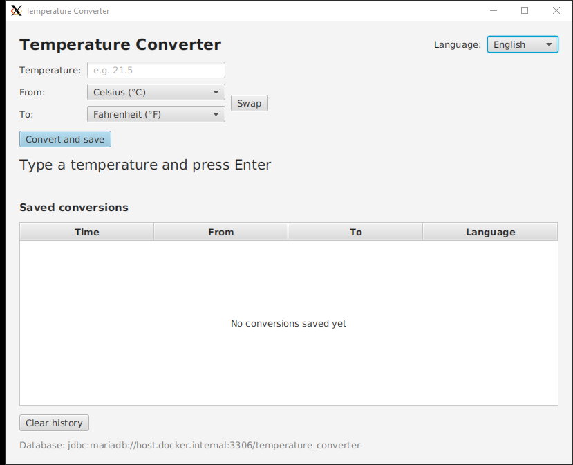
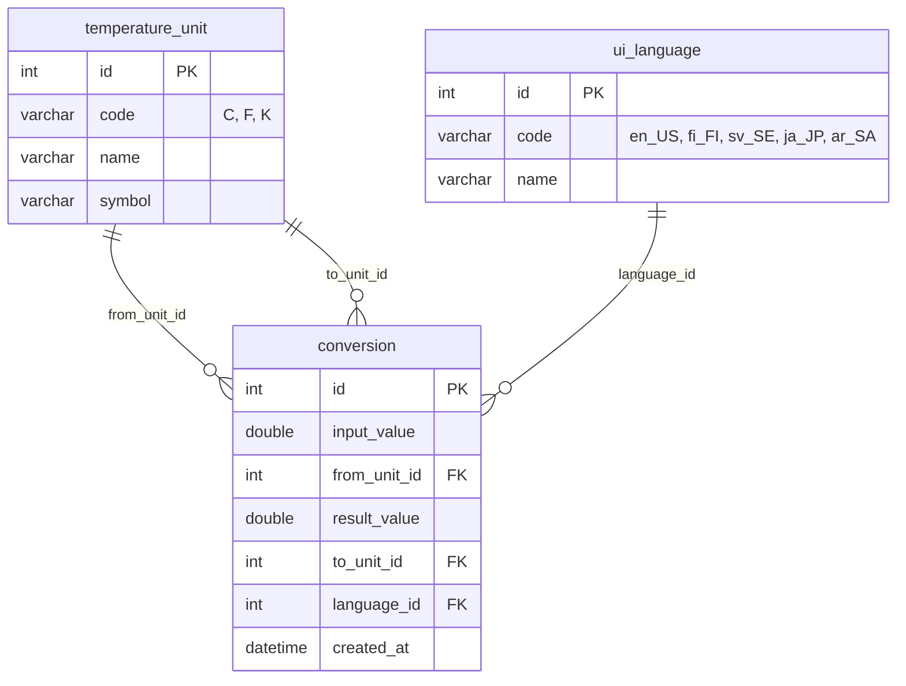

Tom Laukkanen – Ohjelmistotuotantoprojekti 1, JavaFX localization assignment

## 1. Assignment Description

Turn the localized Temperature Converter into a JavaFX application that saves its conversions to a
database, localize the window into five languages with FXML and resource bundles, test it with
JaCoCo coverage, build and push the Docker image with Jenkins, show the GUI through Xming, and run
it in minikube.

| Deliverable                     | Location |
|---------------------------------|----------|
| JavaFX app (FXML + controller)  | `src/main/java/com/example/Main.java`, `MainController.java`, `src/main/resources/com/example/main-view.fxml` |
| Languages                       | `src/main/java/com/example/Language.java` |
| Resource bundles (UTF-8)        | `src/main/resources/MessagesBundle_{en_US,fi_FI,sv_SE,ja_JP,ar_SA}.properties` |
| Conversion logic                | `src/main/java/com/example/TempCalculator.java` |
| Database access                 | `DBConnection.java`, `TemperatureUnitDAO.java`, `ConversionDAO.java`, `src/main/resources/db/schema.sql`, `database/create_database.sql` |
| Unit tests                      | `src/test/java/com/example/` (201 tests) |
| Maven build + JaCoCo            | `pom.xml`, `mvnw`, `mvnw.cmd` |
| Docker image                    | `Dockerfile` → [`tomlaukkanen/temperature-converter-javafx-i18n`](https://hub.docker.com/r/tomlaukkanen/temperature-converter-javafx-i18n) |
| CI/CD pipeline                  | `Jenkinsfile` |
| Kubernetes (minikube)           | `k8s/temperature-converter.yaml` |
| Screenshots                     | `../img/javafx_localization/` |

## 2. Technologies

| Category   | Tool |
|------------|------|
| Language   | Java 21 (`maven.compiler.release` 21) |
| GUI        | JavaFX 21 (controls + FXML) |
| i18n       | `ResourceBundle`, `Locale`, `MessageFormat`, `NumberFormat`, `DateTimeFormatter`, `NodeOrientation` |
| Database   | MariaDB 11 (JDBC driver `mariadb-java-client`), H2 in-memory database for the tests |
| Build      | Maven 3.9 via the Maven Wrapper, Shade plugin for a runnable jar |
| Testing    | JUnit 5 (Jupiter, parameterized tests) |
| Coverage   | JaCoCo 0.8 (report + `check` rule) |
| CI/CD      | Jenkins (declarative pipeline), Docker Desktop, Docker Hub |
| GUI in Docker | Xming X server on Windows |
| Kubernetes | minikube, kubectl |

## 3. Implementation

### The window



The window is described in `main-view.fxml`. Every text in it is a resource key such as
`text="%button.convert"`, which the `FXMLLoader` fills in from the resource bundle it is given.
`MainController` fills in the unit lists and the history from the database, converts, saves, and
writes all messages in the chosen language.

- Type a temperature, pick the *from* and *to* units (Celsius, Fahrenheit, Kelvin) and press
  **Convert and save** (or Enter). The result is shown and the conversion saved to the database.
- **Swap** exchanges the units, **Clear history** deletes the saved conversions.
- The table lists every saved conversion, newest first: time, input, result and the language the
  window was in when it was saved.
- Invalid input, temperatures below absolute zero and database errors are reported in the chosen
  language. Temperatures below −40 °C or above 50 °C get an extra warning.

### Languages and dynamic switching

The language drop-down in the top corner lists every language in its own script:

| Language | Locale  | Bundle                            | Notes |
|----------|---------|-----------------------------------|-------|
| English  | `en_US` | `MessagesBundle_en_US.properties` | default |
| Suomi    | `fi_FI` | `MessagesBundle_fi_FI.properties` | decimal comma, minus sign − |
| Svenska  | `sv_SE` | `MessagesBundle_sv_SE.properties` | decimal comma, minus sign − |
| 日本語    | `ja_JP` | `MessagesBundle_ja_JP.properties` | full-width input (３７．５) accepted |
| العربية   | `ar_SA` | `MessagesBundle_ar_SA.properties` | right-to-left window, Arabic-Indic digits ٣٧٫٥ |

Picking a language reloads the window right away (`Main.switchLanguage`):

1. `ResourceBundle.getBundle("MessagesBundle", locale)` loads the new language's texts.
2. `main-view.fxml` is loaded again with that bundle, and the new root replaces the old one in
   the same window. The window title comes from the bundle too.
3. For Arabic the root's `NodeOrientation` is `RIGHT_TO_LEFT`, which mirrors the whole layout.
4. The typed value, the chosen units and the last result are carried over, and the last result
   is written again in the new language.

Numbers and dates are formatted with the chosen locale: `25,00 °C` in Finnish, `−40,00 °C` in
Swedish, `٢٥٫٠٠ °C` in Arabic, and the history's time column as `30.10.2026 14.05.09`,
`2026/10/30 14:05:09` and so on. The input field accepts numbers written in any of these ways
(`TempCalculator.normalizeNumber`). In Arabic, Latin text such as `°C` is wrapped in invisible
left-to-right marks so it is not shown backwards (`C°`), and the right-to-left marks Java puts into
Arabic numbers and dates are removed, because the Linux fonts in the Docker image draw them as boxes.

### UTF-8

- The `.properties` files are saved as UTF-8 with the real characters (`ä`, `å`, `温度`, `العربية`),
  not `\u` escapes. Java 9+ reads properties bundles as UTF-8, and `project.build.sourceEncoding`
  is UTF-8 so Maven copies them unchanged.
- A test decodes every bundle with a strict UTF-8 decoder, so a file saved as ISO-8859-1 fails
  the build. Other tests check that every bundle has the same keys as English and is translated.
- The database is created with `utf8mb4`, so the Japanese and Arabic language names are stored
  correctly. The Docker image sets `LANG=C.UTF-8` and installs fonts for Japanese and Arabic.

### Database

Three related tables (created by the app on start from `src/main/resources/db/schema.sql`):



- `temperature_unit`: Celsius, Fahrenheit and Kelvin.
- `ui_language`: the five languages, with the same codes as the Java locales (`fi_FI`…).
- `conversion`: every saved conversion. Both units and the language are foreign keys
  (many-to-one), so a conversion cannot point to a unit or a language that does not exist.

`ConversionDAO` saves a conversion (looking up the language id by its code) and reads the history
with a join over all three tables. The connection comes from the environment variables `DB_URL`,
`DB_USER` and `DB_PASSWORD`; without them the local MariaDB from `database/create_database.sql` is
used. The app uses the same `temperature_converter` database as the in-class 1 assignment: it
shares `temperature_unit` and adds the tables `ui_language` and `conversion`.

## 4. Testing & Coverage

```
mvnw.cmd clean verify
```

| Test class              | Tests | What it verifies |
|-------------------------|------:|------------------|
| `TempCalculatorTest`    | 90 | All conversions between C, F and K, absolute zero, extreme temperatures, parsing including `−40,5`, `٢١٫٥` and `３７．５` |
| `MainTest`              | 35 | Drives the real window: start in English, convert and save, errors, swap, clear, switching to every language (titles, buttons, columns), Arabic right-to-left, state kept after switching, Finnish/Swedish/Japanese/Arabic number formats, no database |
| `LanguageTest`          | 39 | The five languages, codes, right-to-left, every bundle exists, has the same keys as English, is translated, is valid UTF-8, and every language is in `ui_language` |
| `ConversionDAOTest`     | 13 | Save, read back with the units and language joined in, every language can be saved, newest first, delete, foreign keys reject unknown units and languages |
| `DBConnectionTest`      | 10 | Settings from the environment, schema created and safe to run again, Japanese and Arabic names stored |
| `TemperatureUnitDAOTest`, `TemperatureUnitTest`, `ConversionTest` | 14 | Units and conversions as objects and in the database |

The database tests use an in-memory H2 database in MariaDB mode, so the tests need no MariaDB server.

**Result (2026-10-30):**

```
Tests run: 201, Failures: 0, Errors: 0, Skipped: 0
All coverage checks have been met.
BUILD SUCCESS
```

**JaCoCo coverage** (`target/site/jacoco/index.html`): 98 % of instructions, 97 % of branches.

| Class                | Instructions | Branches |
|----------------------|-------------:|---------:|
| `TempCalculator`     | 100 % | 100 % |
| `Language`           | 100 % | 100 % |
| `MainController`     | 100 % | 95 %  |
| `TemperatureUnitDAO` | 100 % | 100 % |
| `ConversionDAO`      | 97 %  | 75 %  |
| `DBConnection`       | 94 %  | 94 %  |
| `Main`               | 91 %  | 100 % |
| `Launcher`           | 0 %   | –     |

`mvnw verify` also runs a JaCoCo `check` rule that fails the build if line coverage of the core
logic (everything except the window classes, whose tests need a display) drops below 95 % or
branch coverage below 90 %.

## 5. How to Run

Prerequisites: JDK 21 or newer (Maven comes with the wrapper) and a MariaDB server.

### Database

Once, as root (also fine if the database already exists from the in-class 1 assignment):

```
"C:\Program Files\MariaDB 11.7\bin\mariadb.exe" -u root -p < database\create_database.sql
```

### Locally

```
mvnw.cmd clean package
java -jar target\temperature-converter.jar
```

or straight from the sources: `mvnw.cmd javafx:run`.

### Docker + Xming

1. Start Xming with **No Access Control** (XLaunch: *Multiple windows*, display 0, tick
   *No Access Control*), or run `Xming.exe :0 -multiwindow -clipboard -ac`.
2. Build and run the image. The window opens in Xming and the conversions are saved to the MariaDB
   on the host (`host.docker.internal`):

```
docker build -t tomlaukkanen/temperature-converter-javafx-i18n .
docker run --rm tomlaukkanen/temperature-converter-javafx-i18n
```

Or use the published image: `docker pull tomlaukkanen/temperature-converter-javafx-i18n`.
Another database can be given with `-e DB_URL=... -e DB_USER=... -e DB_PASSWORD=...`.
On start the app creates the tables `ui_language` and `conversion` in the host's MariaDB:

```
"C:\Program Files\MariaDB 11.7\bin\mariadb.exe" -u temp_app -p temperature_converter -e "SELECT * FROM ui_language"
```

### Jenkins

Create a Pipeline job with *Pipeline script from SCM*, this repository and the script path
`OTP1_javafx_localization_TomLaukkanen/Jenkinsfile`. Stages: Checkout → Build → Test → Code
Coverage (report + check) → Publish Test Results → Publish Coverage Report → Build Docker Image →
Push Docker Image to Docker Hub (tags `latest` and the build number). The agent needs the JUnit
and JaCoCo plugins, a desktop session for the window tests, and Docker Desktop signed in to
Docker Hub as the user that runs Jenkins.

### Kubernetes (minikube)

`k8s/temperature-converter.yaml` runs MariaDB (with a persistent volume and a Service named
`mariadb`) and the app from Docker Hub. The app waits for the database, connects to it through the
Service and opens its window on Xming through `host.minikube.internal:0.0`.

```
minikube start
kubectl apply -f k8s/temperature-converter.yaml
kubectl get pods -w
kubectl logs deployment/temperature-converter
```

Start Xming with *No Access Control* first, as above. To try a locally built image without Docker
Hub: `minikube image load tomlaukkanen/temperature-converter-javafx-i18n:latest`. Remove everything
with `kubectl delete -f k8s/temperature-converter.yaml`.
