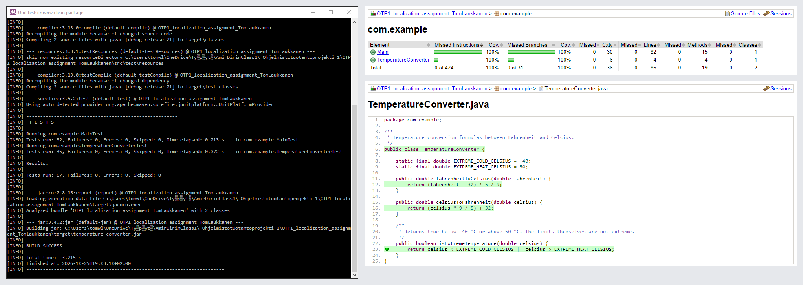
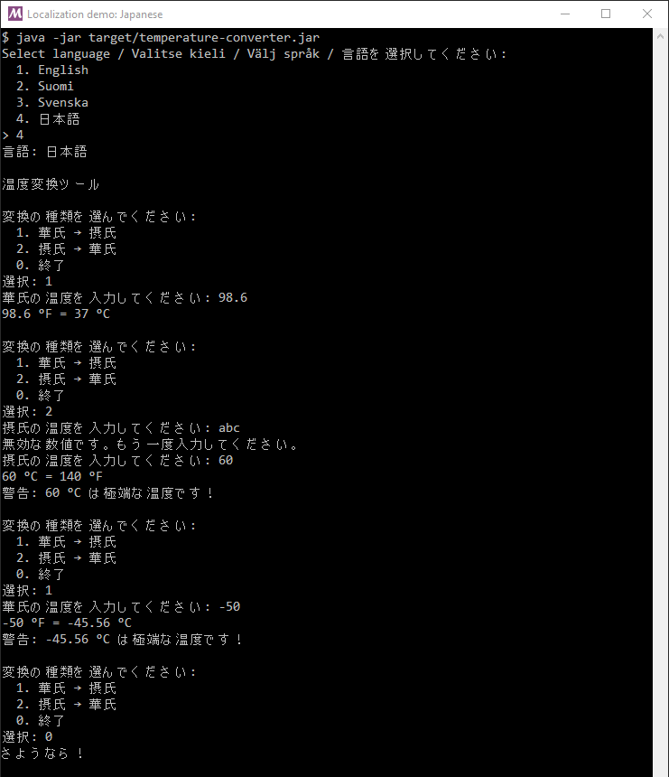

Tom Laukkanen – Ohjelmistotuotantoprojekti 1, localization assignment

## 1. Assignment Description

Implement a `TemperatureConverter` class, localize the application into four languages, test it
with JUnit 5, measure coverage with JaCoCo, and automate build → test → coverage → Docker Hub with
a CI/CD pipeline.

| Deliverable                | Location                                                        |
|----------------------------|-----------------------------------------------------------------|
| Converter class            | `src/main/java/com/example/TemperatureConverter.java`           |
| Console app (language menu)| `src/main/java/com/example/Main.java`                           |
| Resource bundles (UTF-8)   | `src/main/resources/MessagesBundle_*.properties`                |
| Unit tests                 | `src/test/java/com/example/TemperatureConverterTest.java`, `MainTest.java` |
| Maven build + JaCoCo       | `pom.xml`, `mvnw`, `mvnw.cmd`                                   |
| Docker image               | `Dockerfile` (published as `tomlaukkanen/temperature-converter-i18n`) |
| CI/CD pipeline             | `Jenkinsfile`                                                   |
| Screenshots                | `../img/localization/`                                          |

## 2. Technologies

| Category | Tool |
|----------|------|
| Language | Java 21 (`maven.compiler.release` 21) |
| i18n     | `ResourceBundle`, `Locale`, `MessageFormat` |
| Build    | Maven 3.9 via the Maven Wrapper |
| Testing  | JUnit 5 (Jupiter, parameterized tests) |
| Coverage | JaCoCo 0.8 |
| CI/CD    | Jenkins (declarative pipeline), Docker Desktop, Docker Hub |

## 3. Implementation

### TemperatureConverter

| Method | Formula / rule |
|--------|----------------|
| `fahrenheitToCelsius(double fahrenheit)` | `(fahrenheit - 32) * 5 / 9` |
| `celsiusToFahrenheit(double celsius)`    | `(celsius * 9 / 5) + 32` |
| `isExtremeTemperature(double celsius)`   | `true` below −40 °C or above 50 °C (the limits themselves are not extreme) |

### Localization

At launch the app asks for a language. The prompt is written in all four languages, since no
language has been chosen yet:

```
Select language / Valitse kieli / Välj språk / 言語を選択してください:
  1. English
  2. Suomi
  3. Svenska
  4. 日本語
```

| Choice | Locale  | Bundle                             |
|--------|---------|------------------------------------|
| 1      | `en_US` | `MessagesBundle_en_US.properties` (default) |
| 2      | `fi_FI` | `MessagesBundle_fi_FI.properties`  |
| 3      | `sv_SE` | `MessagesBundle_sv_SE.properties`  |
| 4      | `ja_JP` | `MessagesBundle_ja_JP.properties`  |

Any other input falls back to English. After that every menu, prompt, result, warning and error
comes from the chosen bundle.

UTF-8 is handled at every step:

- The `.properties` files are saved as UTF-8 with the real characters (`ä`, `å`, `温度`), not
  `\u` escapes. Java 9+ reads properties bundles as UTF-8, and `project.build.sourceEncoding` is
  UTF-8 so Maven copies them unchanged.
- `Main` prints through a UTF-8 `PrintStream`, so the output is the same on Windows, Linux and in
  Docker. The Docker image also sets `LANG=C.UTF-8`.
- A test decodes every bundle with a strict UTF-8 decoder, so a file saved as ISO-8859-1 fails the
  build.

Numbers are formatted with the chosen locale through `MessageFormat`, so Finnish and Swedish show
a decimal comma (`37,5 °C = 99,5 °F`). Input accepts both `37.5` and `37,5`.

## 4. Testing & Coverage

```
mvnw.cmd clean package
```

| Test class                | Tests | What it verifies |
|---------------------------|------:|------------------|
| `TemperatureConverterTest`| 35    | `fahrenheitToCelsius` and `celsiusToFahrenheit` with 7 inputs each (freezing, boiling, body temperature, −40, absolute zero…), round trips, `isExtremeTemperature` at −40, 50, −41, 51 and just inside / outside both limits |
| `MainTest`                | 32    | Language choice → locale, invalid choice → English, app runs in each language, Japanese conversion, Finnish decimal comma, extreme warnings, invalid number / menu choice, end of input, all bundles have the same keys, bundles are valid UTF-8 |

**Result (2026-10-25):**

```
Tests run: 67, Failures: 0, Errors: 0, Skipped: 0
BUILD SUCCESS
```

**JaCoCo coverage** (`target/site/jacoco/index.html`):

| Class                  | Instructions | Branches | Lines |
|------------------------|-------------:|---------:|------:|
| `TemperatureConverter` | 100 % | 100 % (4/4)   | 100 % |
| `Main`                 | 100 % | 100 % (27/27) | 100 % |



## 5. How to Run

Prerequisite: JDK 21 or newer (Maven comes with the wrapper).

### Locally

```
mvnw.cmd clean package
chcp 65001
java -jar target\temperature-converter.jar
```

`chcp 65001` switches the Windows console to UTF-8 so Japanese and Nordic letters show correctly.
Japanese also needs a console font with Japanese glyphs (Windows Terminal works out of the box).



### Docker

```
docker build -t tomlaukkanen/temperature-converter-i18n .
docker run -it --rm tomlaukkanen/temperature-converter-i18n
```

`-it` is needed because the app reads from the keyboard. Or use the published image:
`docker pull tomlaukkanen/temperature-converter-i18n`.

### Jenkins

Create a Pipeline job with *Pipeline script from SCM*, this repository and the script path
`OTP1_localization_assignment_TomLaukkanen/Jenkinsfile`. Stages: Checkout → Build → Test →
Code Coverage → Publish Test Results → Publish Coverage Report → Build Docker Image → Push to
Docker Hub (tags `latest` and the build number). The agent needs the JUnit and JaCoCo plugins and
Docker Desktop signed in to Docker Hub as the user that runs Jenkins.
